<div align="center">

<a href="https://anuragshre.vercel.app/">
  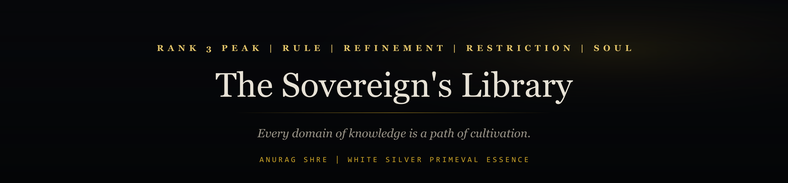
</a>

<br><br>

<a href="https://anuragshre.vercel.app/">
  
</a>

<br>

<h1>Anurag Shre</h1>

<p>
  <code>RANK 3 PEAK</code>
  &nbsp;·&nbsp;
  <code>RULE</code>
  &nbsp;·&nbsp;
  <code>REFINEMENT</code>
  &nbsp;·&nbsp;
  <code>RESTRICTION</code>
  &nbsp;·&nbsp;
  <code>SOUL</code>
</p>

<p>
  <i>Clan Elder · Co-Founder of NOIR'S ANVIL</i><br>
  <i>White Silver Primeval Essence</i>
</p>

<br>

<p>
  I notice the small things that could become something bigger.<br>
  A line of code. A design choice. A habit on a team.<br>
  Those quiet shifts often move the whole system.
</p>

<p>
  I like building things that feel like they have a story.<br>
  Easy to read on the surface, honest underneath.<br>
  I borrow mental models from biology, psychology, and physics when it helps.
</p>

<br>

<p>
  <a href="https://anuragshre.vercel.app/"></a>
  <a href="https://www.linkedin.com/in/anuragshre/"></a>
  <a href="https://www.youtube.com/@Anurag_Shre"></a>
  <a href="https://sovereign-immortal-demon.itch.io/"></a>
  <a href="mailto:anuragshre2005@gmail.com"></a>
</p>

<br>


<br>

```text
while True:
    walk_upstream()
```

<p>
  <i>Perseverance is what is left when everything else falls away.</i>
</p>

<p>
  <small>
    Keep walking against the current.<br>
    There is no map, no clock, and no promised reward.<br>
    Just the next step.
  </small>
</p>

<br>


<br>

## Who I Am

<p>
  <small>A little about me, where I study, and the places I work with.</small>
</p>

<br>

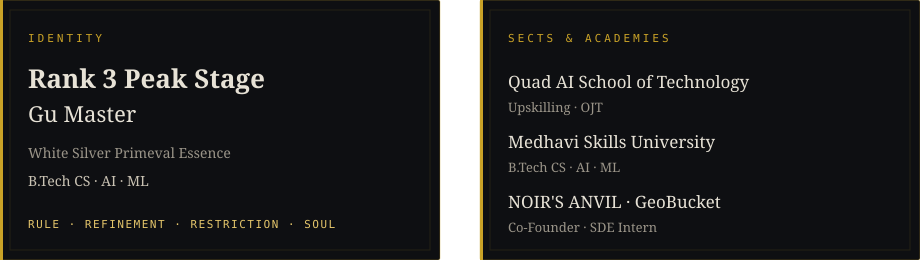

<br><br>

### What I Carry

<p>
  <small>
    Six Gu sit in the aperture.<br>
    <b>Chaotic Planning</b> is my vital Gu. The others keep me honest on the path.
  </small>
</p>

<br>

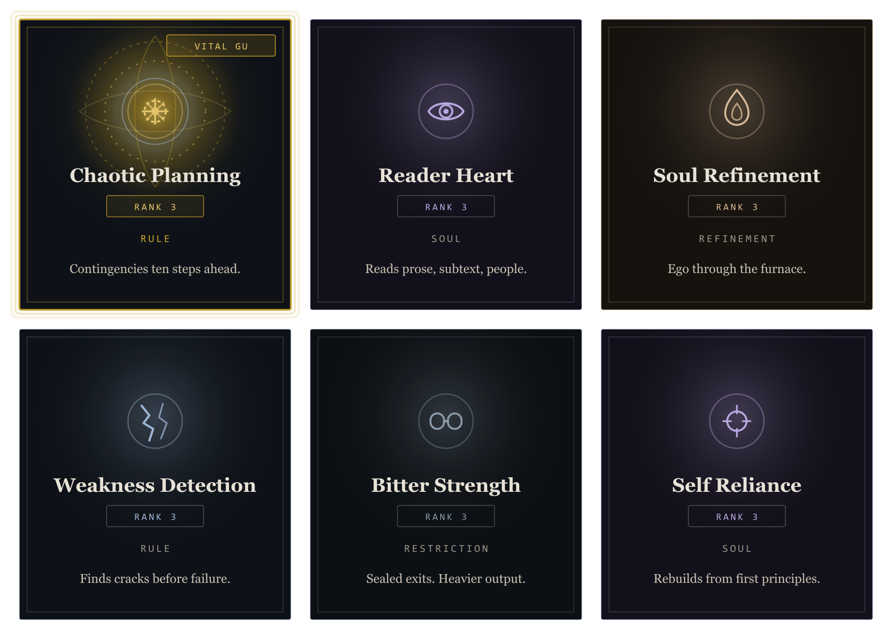

<br>


<br>

## Where I've Been

<p>
  <small>
    Internships, founding work, and training, laid out like a hand of cards.<br>
    The portfolio has the longer story behind each one if you want it.
  </small>
</p>

<br>

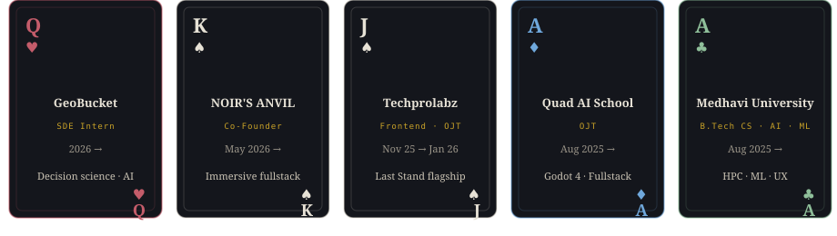

<br>


<br>

## What I've Built

<p>
  <small>
    Work that is meant to actually run.<br>
    Systems, desktop tools, games, and a few smaller experiments.<br>
    If you only open one link, make it <b>Venerable OS</b>.
  </small>
</p>

<br>

<table>
  <tr>
    <td align="center" width="33%">
      <a href="https://github.com/Sovereign-Immortal/venerable-os">
        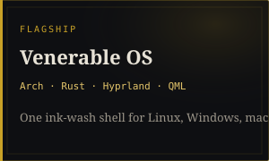
      </a>
    </td>
    <td align="center" width="33%">
      <a href="https://github.com/Sovereign-Immortal/mausam">
        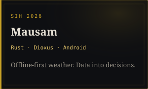
      </a>
    </td>
    <td align="center" width="33%">
      <a href="https://github.com/Sovereign-Immortal/pdf_scope">
        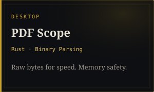
      </a>
    </td>
  </tr>
  <tr>
    <td align="center">
      <a href="https://sovereign-immortal-demon.itch.io/last-stand">
        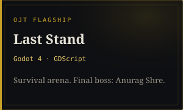
      </a>
    </td>
    <td align="center">
      <a href="https://github.com/Sovereign-Immortal/GenLink-Anti-Scam-Bodyguard">
        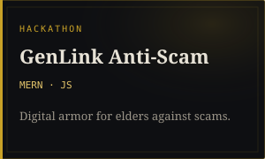
      </a>
    </td>
    <td align="center">
      <a href="https://github.com/Sovereign-Immortal/Art-of-noticing">
        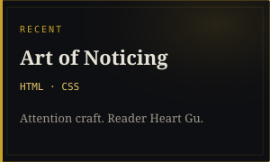
      </a>
    </td>
  </tr>
  <tr>
    <td colspan="3" align="center">
      <a href="https://do-you-know-dev-duel.vercel.app/">
        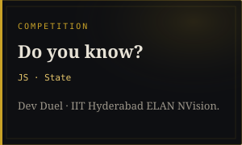
      </a>
    </td>
  </tr>
</table>

<br>


<br>

## How I Think

<p>
  <small>
    I try not to let my domains fight each other.<br>
    Clarity, detachment, and strategy work better when they share one aperture.
  </small>
</p>

<br>

<a href="https://anuragshre.vercel.app/">
  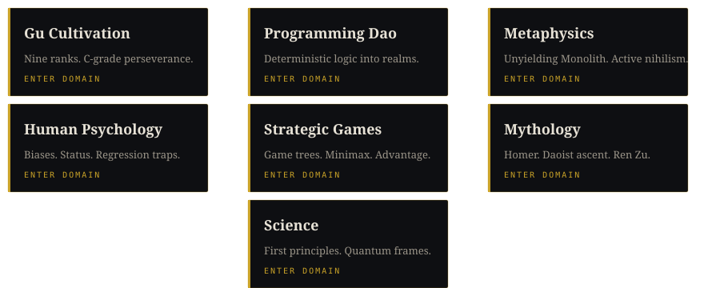
</a>

<br><br>

### Tools of the Trade

<p>
  <small>What I already know well, and what I am still learning.</small>
</p>

<br>

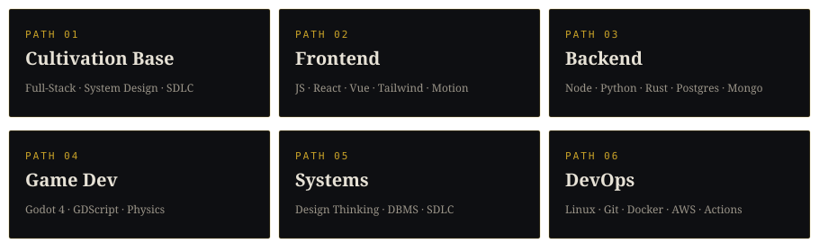

<br>


<br>

## What I Read & Play

<p>
  <small>
    Books, novels, and games that stayed with me.<br>
    The gold meters are personal. How deeply something settled in, not a score for anyone else.
  </small>
</p>

<br>

### Webnovels

<br>

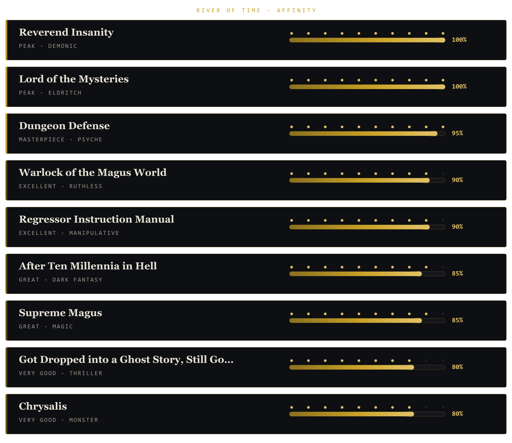

<br><br>

### Ancient Texts

<br>

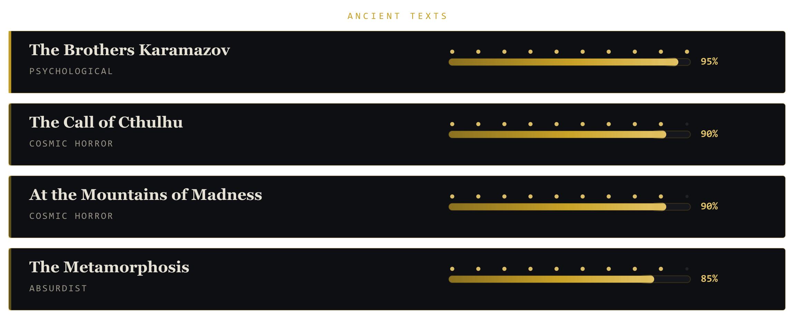

<br><br>

### Philosophy

<br>

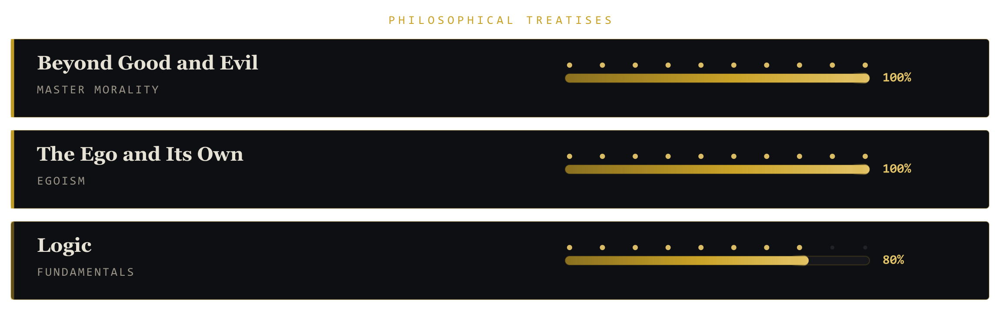

<br><br>

### Worldly Wisdom

<br>

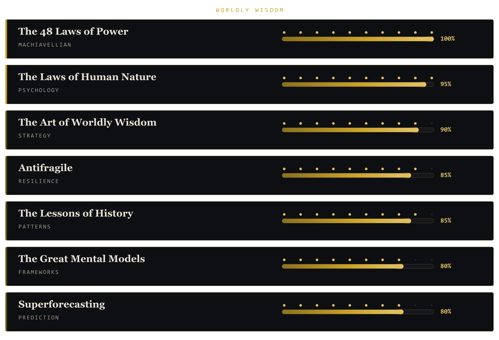

<br><br>

### Games

<br>

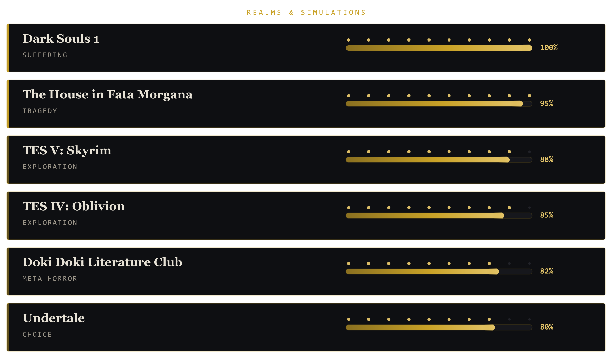

<br>


<br>

## On the Path

<p>
  <small>A public look at commits, streaks, and languages.</small>
</p>

<br>


<br><br>


<br><br>


<br>

<p>
  <sub>© 2026 Anurag Shre · The Sovereign Library</sub>
</p>

<p>
  <sub>
    <a href="https://github.com/Sovereign-Immortal">github.com/Sovereign-Immortal</a>
    &nbsp;·&nbsp;
    <a href="mailto:anuragshre2005@gmail.com">anuragshre2005@gmail.com</a>
  </sub>
</p>

</div>
